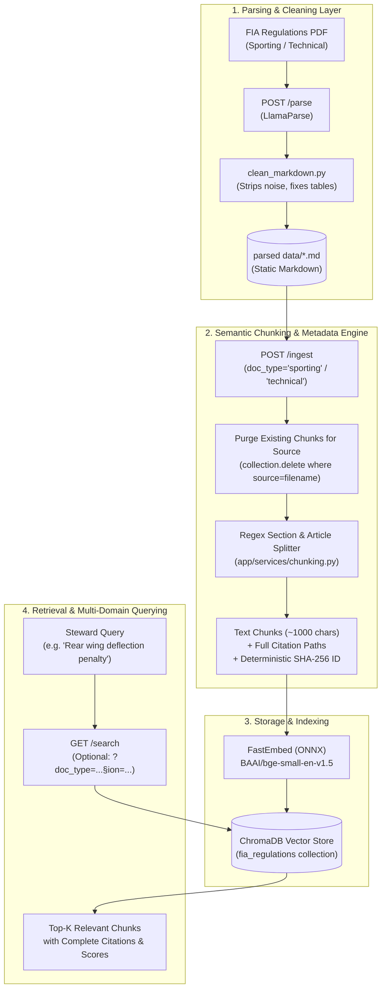
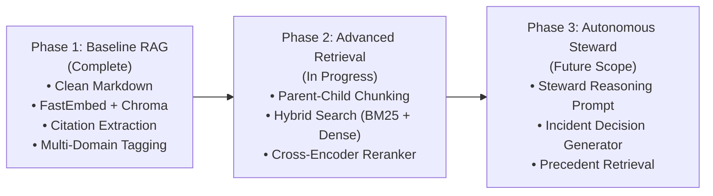

# 🏎️ FIA Steward AI

> **Autonomous F1 Regulation Assistant & Steward Incident Referee**  
> An agentic RAG system built to analyze Formula 1 race incidents, cross-reference official FIA regulations (Sporting, Technical, and Financial), cite precise Article and Sub-Article clauses, and assist stewards in penalty deliberations.

---

## 📌 Project Overview & Vision

During a Grand Prix weekend, race stewards must make split-second decisions on complex, multi-car incidents (e.g., pit lane speeding, unsafe releases, track limits, technical non-compliance, collisions under yellow flags). Stewards must cross-reference hundreds of pages across different rulebooks:
* **Section B:** Sporting Regulations (Procedures, driving conduct, safety cars, penalties)
* **Section C:** Technical Regulations (Car dimensions, wing flex, legality, power units)
* **Section D:** Financial Regulations (Cost cap and reporting)

### 🎯 Ultimate Objective
To accept real-world race incident reports (driver telemetry, marshal notes, steward summons), perform multi-rulebook legal analysis, and output official steward verdict drafts with exact regulatory citations, precedents, and applicable penalties.

### 🔬 Current Milestone & Purpose
Currently, this repository serves as a **production-grade RAG testbed** solving core distributed data engineering challenges:
1. **Multi-Domain / Multi-Tenant Rulebook Bridging:** Ingesting and querying across distinct regulation manuals (Sporting vs Technical) in a single unified vector space with scoped or cross-domain querying.
2. **Deterministic Deduplication & Idempotent Ingestion:** Preventing chunk duplication and stale data accumulation via content-hashed IDs and purge-on-ingest mechanisms.
3. **Regulatory Citation Extraction:** Parsing complex legal documents into semantic chunks tagged with complete regulatory hierarchy (`Article Number`, `Article Title`, `Sub-Section`, `Domain`).
4. **Zero-Cost, Local Embeddings:** High-throughput CPU inference using ONNX-based **FastEmbed** (`BAAI/bge-small-en-v1.5`) without third-party API keys or rate limits.
5. **Decoupled Architecture:** One-time PDF parsing and markdown cleaning separated cleanly from downstream chunking, embedding, and vector storage.

---

## 🏗️ System Architecture



---

## 📊 Evaluation & Benchmark Results

To scientifically measure retrieval quality, the repository includes a ground-truth synthetic test suite ([`tests/data/synthetic_eval_set.json`](tests/data/synthetic_eval_set.json)) covering 20 realistic race incident questions across all major regulation categories (Pit Lane, Safety Car, Tyre rules, Scrutineering, Parc Fermé, Driver Changes, Red Flags).

### Baseline Retrieval Scorecard (Recall@k & MRR)

| Metric | Baseline Score | Target Threshold | Performance Status |
| :--- | :---: | :---: | :---: |
| **Recall@1** | **70.0%** | > 65% | 🟢 Exceeds Baseline |
| **Recall@3** | **80.0%** | > 80% | 🟢 Target Reached |
| **Recall@5** | **90.0%** | > 85% | 🟢 High Accuracy |
| **MRR (Mean Reciprocal Rank)** | **0.767** | > 0.70 | 🟢 Top-tier Precision |
| **Total Success Rate** | **18 / 20 Hits** | - | **Only 2 misses out of 20** |

```text
-------------------------------------------------------
                 OVERALL SCORECARD                     
-------------------------------------------------------
  Recall@1       :   70.0%
  Recall@3       :   80.0%
  Recall@5       :   90.0%
  MRR            :  0.767
-------------------------------------------------------

  Breakdown by Category:
   • Driving Standards         : Recall@3=100.0% | Recall@5=100.0%
   • Safety Car & Race Control : Recall@3=100.0% | Recall@5=100.0%
   • Tyre Regulations          : Recall@3=100.0% | Recall@5=100.0%
   • Scrutineering & Weighing  : Recall@3=100.0% | Recall@5=100.0%
   • Pit Lane & Safety         : Recall@3=100.0% | Recall@5=100.0%
```

---

## 🚀 Quickstart & Setup Guide

### 1. Prerequisites
* **Docker & Docker Compose** (Recommended)
* **Python 3.11+** (for running local scripts)
* A [LlamaCloud API Key](https://cloud.llamaindex.ai/) (only required if parsing raw PDFs)

### 2. Environment Configuration
Create a `.env` file in the project root:
```env
CHROMA_HOST=chroma
LLAMA_CLOUD_API_KEY=your_llamacloud_api_key_here
```

### 3. Build & Run with Docker Compose
```bash
docker compose up --build
```
This boots:
* **FastAPI Backend:** `http://localhost:8000` (Interactive Swagger Docs at `http://localhost:8000/docs`)
* **ChromaDB Vector Service:** `http://localhost:8001` (Host port)

---

## 🛠️ API Endpoints & Workflows

### 1. Parse PDF to Clean Markdown
Uploads raw regulation PDF, cleans tables and whitespace, and outputs a static `.md` file to `parsed data/`:
```bash
curl -X POST "http://localhost:8000/parse" \
  -H "Content-Type: multipart/form-data" \
  -F "file=@regulations.pdf"
```

### 2. Ingest Cleaned Markdown into ChromaDB
Chunks the file with Article & Sub-Article citations, generates FastEmbed embeddings, and stores them in ChromaDB.
```bash
# Ingest Sporting Regulations (Section B)
curl -X POST "http://localhost:8000/ingest" \
  -H "Content-Type: application/json" \
  -d '{
    "filename": "FIA 2027 F1 Regulations - Section B _Sporting_ - Iss 01 - 2026-10-19.md",
    "doc_type": "sporting",
    "section": "B"
  }'

# Ingest Technical Regulations (Section C)
curl -X POST "http://localhost:8000/ingest" \
  -H "Content-Type: application/json" \
  -d '{
    "filename": "FIA 2027 F1 Regulations - Section C _Technical_ - Iss 04 -  2026-10-19.md",
    "doc_type": "technical",
    "section": "C"
  }'
```

### 3. Search & Cross-Reference Regulations
```bash
# Cross-domain search (bridges both Sporting & Technical)
curl "http://localhost:8000/search?q=rear+wing+deflection+penalty&k=4"

# Domain-scoped search (Technical only)
curl "http://localhost:8000/search?q=wing+dimensions&section=C&k=3"

# Domain-scoped search (Sporting only)
curl "http://localhost:8000/search?q=pit+lane+speed+limit&section=B&k=3"
```

### 4. Database Inspection & Maintenance
```bash
# Inspect collection count and peek sample chunks
curl "http://localhost:8000/inspect?limit=5"

# Clear / reset collection
curl -X POST "http://localhost:8000/clear"
```

---

## 💻 CLI Tools & Automation Scripts

The repository includes standalone CLI utilities located in `scripts/`:

| Script | Purpose | Command |
| :--- | :--- | :--- |
| **`evaluate_retrieval.py`** | Runs Recall@k and MRR evaluation across ground-truth questions. | `python scripts/evaluate_retrieval.py --k 1,3,5` |
| **`inspect_db.py`** | Terminal database browser (inspect chunk count, filter by Article). | `python scripts/inspect_db.py --article B1 --limit 5` |
| **`clear_db.py`** | Resets and clears the ChromaDB collection. | `python scripts/clear_db.py` |
| **`generate_synthetic_eval.py`** | Generates new synthetic test questions using an LLM. | `python scripts/generate_synthetic_eval.py --input "parsed data/file.md"` |

---

## 🗂️ Project Directory Layout

```text
FIA-Steward-AI/
├── app/
│   ├── main.py                  # FastAPI application & REST routing
│   └── services/
│       ├── chunking.py          # Regulatory article splitter & citation builder
│       ├── vectorstore.py       # FastEmbed ONNX wrapper & ChromaDB manager
│       └── indexer.py           # Ingestion coordinator & document processor
├── parsed data/                 # Cleaned static .md files (Sporting, Technical)
├── scripts/
│   ├── clean_markdown.py        # Markdown formatting & table cleaner
│   ├── llamaparse.py            # PDF parsing via LlamaParse
│   ├── evaluate_retrieval.py    # Recall@k & MRR evaluation harness
│   ├── inspect_db.py            # Terminal inspection utility
│   ├── clear_db.py              # Chroma reset script
│   └── generate_synthetic_eval.py # Synthetic question generator
├── tests/
│   ├── data/
│   │   └── synthetic_eval_set.json # 20 curated ground-truth test cases
│   ├── test_chunking.py         # Unit tests for regex & citation extraction
│   └── test_ingestion.py        # Unit tests for chunk deduplication
├── docker-compose.yml           # Multi-container orchestration (API + Chroma)
├── Dockerfile                   # Python 3.11 lightweight API container
├── requirements.txt             # Project dependencies
└── README.md                    # Project documentation
```

---

## 🔮 Current Focus & Future Roadmap



### Active Work
* **Parent-Child Hierarchical Chunking:** Indexing small child chunks (~250 chars) for granular semantic search, while passing larger parent chunks (~1,500 chars) to the LLM to preserve complete rule contexts.
* **Hybrid Search (Sparse + Dense):** Combining BM25 keyword matching with FastEmbed dense vectors to resolve regulatory acronyms and terminology gaps (e.g., matching "red flag" with "Session Suspension").

### Future Scope
* **Incident Verdict Generator:** An agentic workflow taking incident inputs (e.g. *"Car 44 passed Car 1 under Safety Car before Line 1"*) and outputting an official FIA Stewards Document with findings, applicable regulations, and penalty precedents.
* **Multi-Modal Steward Inputs:** Ingesting driver radio audio transcripts, telemetry graphs, and onboard camera frames into the decision loop.
* **Historical Precedent Database:** Ingesting past steward decisions (2020–2026) to ensure consistent penalty application across seasons.
